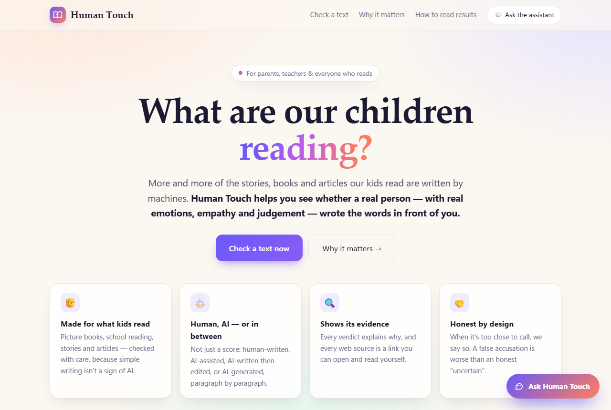
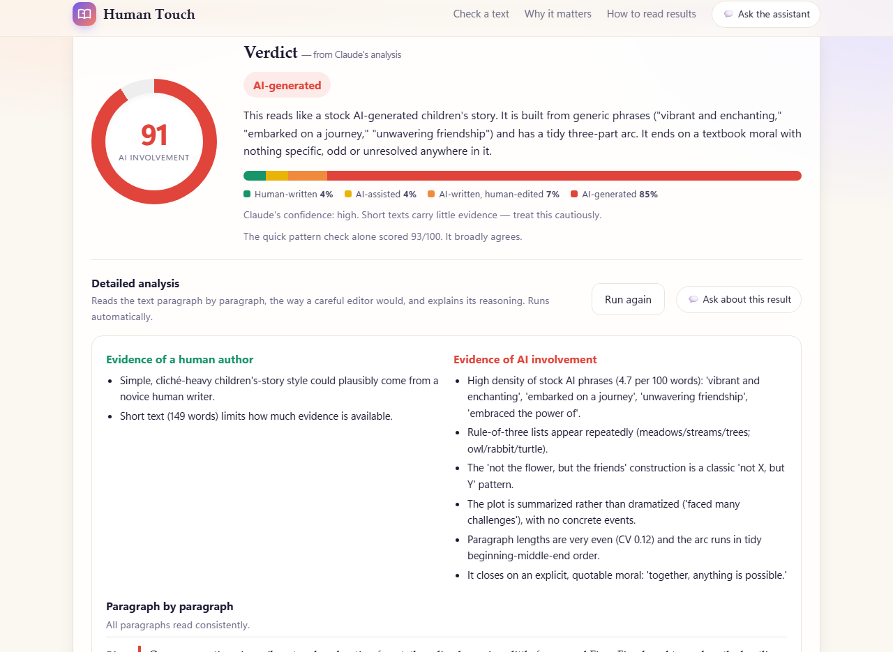

# Human Touch

### What are our children reading?

More and more of the stories, books and articles our kids read are written by machines. **Human Touch helps parents, teachers and readers see whether a real person, with real emotions, empathy and judgement, wrote the words in front of them.** It also checks whether those words were copied from somewhere else.



## Why it's different

- **Made for what kids read.** It handles picture books, school reading, stories and articles carefully, because simple writing is not a sign of AI.
- **Human, AI, or in between.** It doesn't give a single score. The verdict is one of four kinds of authorship, with percentages and a paragraph-by-paragraph breakdown:

  | Verdict | What it means |
  |---|---|
  | 🟢 **Human-written** | A person wrote it without AI help. |
  | 🟡 **AI-assisted** | A person's own draft, polished or expanded by AI: human substance, machine-smooth surface. |
  | 🟠 **AI-written, human-edited** | An AI draft that a person revised: machine skeleton, human patches. |
  | 🔴 **AI-generated** | AI output used as-is. |

- **Shows its evidence.** Every verdict explains why, and every web source is a link you can open and read yourself.
- **Honest by design.** When the evidence is close, it says "too close to call" instead of guessing. A false accusation is worse than an honest "uncertain".
- **An assistant you can ask.** It answers questions about the result, such as "Is this from a published book?" or "Which paragraph looks most AI-written?", and runs refined web searches with cited sources.



## Quick start

You need **Python 3.10+** ([download](https://www.python.org/downloads/)). On Windows, tick *"Add python.exe to PATH"* during setup.

You also need **your own Anthropic API key** ([get one](https://platform.claude.com)). Without a key, only the free quick check works.

```bash
git clone https://github.com/keespace/human-touch.git
```

```bash
cd human-touch
```

Then start it:
- **Windows:** double-click `Start Human Touch.bat`.
- **Mac or Linux:** run `bash start-mac.sh`.

On first run, the script installs the one dependency and creates a `.env` file for your key. It then opens http://localhost:8765. See [GETTING_STARTED.md](GETTING_STARTED.md) for a non-technical walkthrough.

To try it instantly with an example, open http://localhost:8765/?example=kids. You can also use `article` or `essay` in place of `kids`.

## How it works

| Layer | What it does | Runs | Cost |
|---|---|---|---|
| **Quick pattern check** | Measures sentence rhythm, stock AI vocabulary, personal voice, concrete detail, formulaic structure and tidy endings | In your browser | Free |
| **Detailed analysis** | Claude reads the text paragraph by paragraph, with objective measurements as evidence, and gives probabilities for the four categories | Anthropic API | ~$0.03–0.08 per check |
| **Find copies online** | Planned exact-phrase web searches, verified overlap, and every source listed as a clickable link | Anthropic API + web search | ~$0.05–0.15 per search |
| **Assistant** | Answers questions about the result and runs refined searches with citations | Anthropic API + web search | ~$0.02–0.10 per question |

**How the verdict is decided:** the human share is compared with all AI shares combined.
- 60% or more human: the verdict is **human-written**.
- 40% or less human: the verdict is the most likely kind of AI involvement.
- Anything in between: **too close to call**, with the direction it leans.

The quick pattern check is shown alongside the main verdict, but it's easy to fool. For example, AI that imitates a personal voice can pass it. The detailed analysis is the better guide.

## Measuring accuracy

A detector is only as trustworthy as its measured error rate. [`eval/`](eval/README.md) contains a test set and a script that report a confusion matrix and, most importantly, how often real human writing is wrongly flagged.

```bash
python eval/evaluate.py
```

The current test set is small: 1 known-human text and 10 AI-written or AI-assisted texts. **Contributions of known-human texts, especially children's writing, are very welcome.** That's what makes the numbers meaningful.

## Privacy

- The quick check runs entirely in your browser.
- The detailed analysis, web search and assistant send the text to Anthropic's API. Nothing is stored by this app.
- Your API key stays in `.env` on your computer. See [SECURITY.md](SECURITY.md).

## Project layout

```
index.html            the whole user interface (quick check, results, assistant)
server.py             local server and the Claude-powered checks
eval/                 accuracy test set and evaluation scripts
Start Human Touch.bat / start-mac.sh   one-click start with first-run setup
make_share_zip.py     builds a shareable zip without your API key
```

## Important

**Results are evidence, not proof.** No AI detector is reliable enough to accuse anyone. Formal, simple or non-native writing can look AI-like. Please never use this tool's result alone to accuse, grade or discipline a person.

Human Touch uses Claude by Anthropic. It is an independent project and is not affiliated with or endorsed by Anthropic.

## License

[MIT](LICENSE). Free to use, share and adapt.
